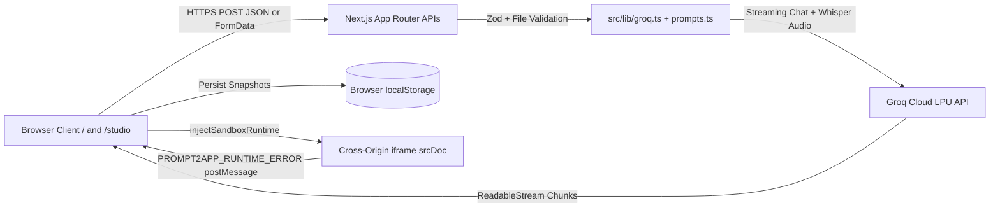
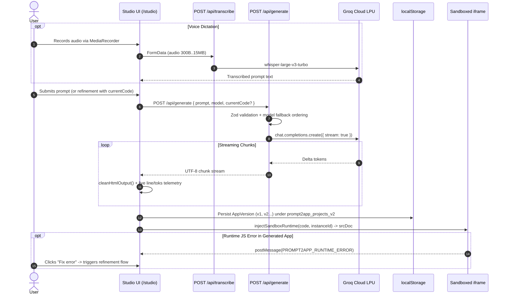
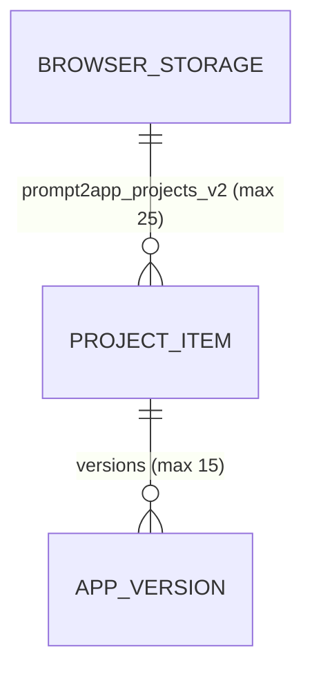

# Prompt2App — Architecture

---

## 1. Stack & Runtime Versions

| Layer | Technology & Exact Version | Runtime / Region / Notes |
|---|---|---|
| Framework | Next.js `16.4.6` (App Router, Turbopack) · TypeScript `7.0.2` (`strict: true`) | Node.js `22.x` · Vercel |
| UI & Styling | React `19.3.1` · Tailwind CSS `3.4.19` · Radix UI (`dialog`, `dropdown-menu`, `scroll-area`, `toast`) · `lucide-react` `1.72.0` | Obsidian dark CSS variables (`#0C0C0E`), self-hosted `Inter` & `JetBrains Mono` (`next/font/google`) |
| Validation | Zod `4.6.7` | Request payload validation in `/api/generate` and `/api/enhance`; byte bounds in `/api/transcribe` |
| AI Code Generation | `groq-sdk` `1.6.0` — `openai/gpt-oss-120b`, `qwen/qwen3.8-27b`, `openai/gpt-oss-20b` | `55s` SDK timeout · `maxRetries: 2` · `max_completion_tokens` up to `32,768` |
| Speech-to-Text | `whisper-large-v3-turbo` via browser `MediaRecorder` + `POST /api/transcribe` | `audio/webm` / `audio/mp4` · `300 B–15 MB` |
| Client Persistence | Browser `localStorage` (`prompt2app_projects_v2`, `prompt2app_active_project_v2`) | Stateless server · up to `25` projects × `15` versions |
| Security & CI | `vercel.json` HTTP headers · cross-origin `<iframe srcDoc>` · GitHub Actions (`CI`, `CodeQL`, `Gitleaks`, `Dependency Review`, `Renovate`) | `Permissions-Policy` allows `microphone=(self)` while isolating iframes |

---

## 2. System Topology & Components



```text
src/
  app/
    api/
      generate/route.ts          Streaming HTML generation & multi-turn refinement (maxDuration = 60)
      enhance/route.ts           AI prompt specification expander (maxDuration = 30)
      transcribe/route.ts        Audio transcription via Groq Whisper V3 Turbo (maxDuration = 30)
    studio/page.tsx              Full-screen Studio Workbench controller (/studio)
    layout.tsx                   Root layout, self-hosted fonts, SEO metadata, JSON-LD
    page.tsx                     Landing page (Hero, Composer, Showcase, Blueprints, FAQ)
    globals.css                  Dark theme tokens & custom scrollbar styles
    icon.svg                     Vector brand icon
    apple-icon.tsx               Dynamic 180x180 Apple touch icon
    opengraph-image.tsx          Dynamic 1200x630 OpenGraph image
    manifest.ts / robots.ts / sitemap.ts
  components/
    brand-logo.tsx               Terminal-prompt brand logo and GitHub SVG mark
    studio/
      studio-header.tsx          Studio header bar for empty state
      workspace-toolbar.tsx      Views (Preview/Code/Split), viewports, model switcher, export
      prompt-composer.tsx        Prompt input, model dropdown, Enhance button, Voice recorder
      voice-recorder-button.tsx  Cross-browser MediaRecorder capture + Whisper upload
      starter-templates.tsx      6 starter prompt chips
      preview-canvas.tsx         Sandboxed iframe stage, device frames, runtime error banner
      code-viewer.tsx            Streaming line-numbered source viewer with live search & copy
      project-sidebar.tsx        Version snapshot history (v1, v2...) & follow-up chat composer
      projects-dialog.tsx        Saved local workspace modal
    ui/                          Radix UI primitives (dialog, dropdown-menu, scroll-area, sheet, toast, toaster)
  hooks/use-toast.ts             Lightweight client toast queue (limit 2, 4.5s auto-dismiss)
  lib/
    groq.ts                      Singleton Groq client, GROQ_MODELS catalog, FALLBACK_MODELS, cleanHtmlOutput()
    prompts.ts                   System prompts (generate, refine, enhance) & STARTER_TEMPLATES
    sandbox.ts                   injectSandboxRuntime() storage shim, link guard & error postMessage bridge
    storage.ts                   Quota-safe localStorage project & version manager
    types.ts                     Shared TypeScript types
    utils.ts                     cn() Tailwind class merger
  types/global.d.ts              CSS and image module declarations for TypeScript 7
```

### Streaming Generation Route (`src/app/api/generate/route.ts`)
Validates `{ prompt, model?, currentCode? }` with Zod, selects `SYSTEM_PROMPT_GENERATE` or `SYSTEM_PROMPT_REFINE`, loops through the requested model plus `FALLBACK_MODELS`, and streams token deltas directly over a `ReadableStream<Uint8Array>`. Exposes `X-Model-Used` and binds both `req.signal` and `ReadableStream.cancel()` to `streamRef.controller.abort()` so cancelled builds immediately stop upstream token generation.

### Studio Workbench (`src/app/studio/page.tsx`)
Coordinates streaming state, `AbortController` cancellation, live `tok/s` calculation (`rawAccumulated.length / 3.8` tokens per elapsed second), immutable version creation, `Preview / Code / Split` switching, Desktop/Tablet/Mobile viewports, mobile drawer/quick-edit UX, and `.html` Blob exports.

### Sandbox Runtime Bridge (`src/lib/sandbox.ts`)
Pre-processes generated HTML before setting `srcDoc` (leaving downloadable `.html` clean). Injects dark scrollbar rules, a `try/catch` in-memory `localStorage` and `sessionStorage` polyfill for opaque origins, an empty `href=""` / `href="#"` navigation guard, and an instance-scoped `window.onerror` + `unhandledrejection` `postMessage` bridge.

---

## 3. End-to-End Request Flow



1. **Input capture:** User types a prompt, expands a draft via `POST /api/enhance`, picks a starter template, or dictates speech via `MediaRecorder` → `POST /api/transcribe`.
2. **Stream orchestration:** `/studio` opens a `fetch` stream with an `AbortController` to `POST /api/generate`.
3. **Deterministic stream cleaning:** `cleanHtmlOutput()` strips reasoning blocks (`<think>...</think>`) and outer markdown fences as chunks arrive.
4. **Local snapshot persistence:** Once complete and verified `>= 30` chars, the un-shimmed HTML is saved as an `AppVersion` inside `prompt2app_projects_v2`.
5. **Isolated preview & repair:** `PreviewCanvas` injects `injectSandboxRuntime()` into `<head>` and renders the app inside an opaque-origin `<iframe srcDoc>`. Any runtime error posts back to the Studio banner for 1-click AI patching.

---

## 4. Client Storage Schema (`localStorage`)

Prompt2App runs zero server databases. All projects and snapshots live locally in the user's browser:



| Storage Key / Entity | Fields & Types | Constraints / Behavior | Purpose |
|---|---|---|---|
| `prompt2app_projects_v2` | `ProjectItem[]` JSON array | Capped at `25` projects, validated on load via `isValidProjectItem()` | Workspace project list |
| `prompt2app_active_project_v2` | `string` (project UUID) | Cleared on "New" or delete | Restores active project on reload |
| `ProjectItem` | `id`, `title` (`<= 42` chars), `createdAt`, `updatedAt`, `currentVersionId`, `versions` | Sorted newest-first on updates | Groups version timeline |
| `AppVersion` | `id`, `versionNumber`, `prompt`, `code`, `model`, `createdAt`, `durationMs?`, `tokensPerSec?` | Capped at `15` latest versions/project | Immutable time-travel snapshots |

**Quota-Safe Pruning (`saveProjects()`):** If `localStorage.setItem` throws `QuotaExceededError`, the manager drops oldest projects iteratively; if even 1 project exceeds quota, it trims that project to its latest `2` versions before retrying.

---

## 5. Caching, State & Concurrency Control

- **Server routes:** Intentionally uncached (`Cache-Control: no-cache, no-transform` on `/api/generate`). `getGroqClient()` caches a single `Groq` SDK instance per `GROQ_API_KEY` value in Node.js process memory.
- **Single active build invariant:** Calling `runGeneration()` first invokes `abortControllerRef.current?.abort()`, preventing overlapping streams from racing state updates.
- **URL handoff deduplication:** `lastHandledSearchRef` ensures query-string launches (`/studio?prompt=...`) execute once even under React Strict Mode re-renders before calling `router.replace('/studio')`.
- **Voice unmount guard:** `VoiceRecorderButton` tracks `unmountedRef` and immediately stops `MediaStream` tracks and `setInterval` timers on unmount.

---

## 6. AI / LLM Design

### Models & Token Budgets

| Task | Provider & Model | Max Input | Max Output | Timeout / Retries | Temperature |
|---|---|---|---|---|---|
| Primary App Generation / Refine | Groq · `openai/gpt-oss-120b` (`~500 tok/s`) | `12,000` char prompt (+ `250,000` char code) | `32,768` tokens | `55s` SDK / `60s` route · 2 retries | `0.3` |
| Frontend Specialist Model | Groq · `qwen/qwen3.8-27b` (`~450 tok/s`) | Same Zod limits | `16,384` tokens | `55s` SDK / `60s` route · 2 retries | `0.3` |
| Rapid Turbo / Fallback | Groq · `openai/gpt-oss-20b` (`~1,000 tok/s`) | Same Zod limits | `32,768` tokens | `55s` SDK / `60s` route · 2 retries | `0.3` |
| Prompt Enhancer | Groq · `gpt-oss-20b` → `120b` → `qwen3.8-27b` | `4,000` char prompt | `600` tokens | `30s` route maxDuration | `0.45` |
| Voice Dictation | Groq · `whisper-large-v3-turbo` | `300 B–15 MB` audio | Transcription JSON | `30s` route maxDuration | `0.0` |

### Input & Pre-Processing
Zod trims leading/trailing whitespace and rejects empty/oversized prompts (`< 2` or `> 12,000` chars on generate, `> 4,000` on enhance) and oversized HTML refinement inputs (`> 250,000` chars) before constructing model messages.

### System Prompt & Output Hygiene
- `SYSTEM_PROMPT_GENERATE` enforces raw `<!DOCTYPE html>...</html>` output, viewport meta, Tailwind CDN, `Inter` / `JetBrains Mono`, realistic sample data, `e.preventDefault()` on forms, and `try/catch` storage wrappers.
- `SYSTEM_PROMPT_REFINE` wraps the existing HTML in an explicit `CURRENT APPLICATION HTML` fenced block separated from `REQUESTED CHANGES / REFINEMENT` and forbids partial snippets, diffs, or omitted-code placeholder comments.
- `cleanHtmlOutput()` deterministically strips `<think>...</think>` blocks, waits out unclosed `<think>` tags during streaming until `<!DOCTYPE html` or `<html` appears, removes leading/trailing markdown fences only at document boundaries (preserving backticks inside JS template literals), and trims trailing prose after `</html>`.

### Failure Handling & Self-Healing
- Both `/api/generate` and `/api/enhance` iterate fallback models if a model throws or returns empty output.
- Generated JS exceptions inside the preview iframe are captured via `window.onerror` / `unhandledrejection` (filtering noisy `ResizeObserver` and opaque `'Script error.'` events) and presented with a 1-click **Fix error** prompt shortcut.

---

## 7. API Contracts

| Method | Route | Auth & Rate Limit | Request Schema / Bounds | Responses (`2xx` / `4xx` / `5xx`) |
|---|---|---|---|---|
| `POST` | `/api/generate` | Public · stateless (no per-IP limiter; Groq fallback) | JSON `{ prompt: 2..12k chars, model?, currentCode?: <=250k }` | `200 text/plain` stream (`X-Model-Used`) · `400` Zod/JSON · `499` abort · `500` config · `502` upstream |
| `POST` | `/api/enhance` | Public · stateless | JSON `{ prompt: 2..4k chars }` | `200 { enhancedPrompt }` · `400` invalid · `499` abort · `500` failure |
| `POST` | `/api/transcribe` | Public · stateless | `multipart/form-data` field `audio` (`File`, `300 B–15 MB`) | `200 { text }` · `400` missing/short · `413` >15 MB · `500` failure |

*(Note: No `/api/health` endpoint is exposed; Vercel platform monitors route availability directly.)*

---

## 8. Security Controls

- **Secrets isolation:** `GROQ_API_KEY` is accessed exclusively in `src/lib/groq.ts` on the Node.js server; zero `NEXT_PUBLIC_` secret variables exist.
- **Cross-origin iframe sandboxing:** Preview iframes use `sandbox="allow-scripts allow-forms allow-popups allow-modals allow-downloads"`, omitting `allow-same-origin` and `allow-top-navigation` so generated JavaScript runs in an opaque origin unable to access host cookies, DOM, or `localStorage`.
- **Scoped `postMessage` & link guard:** Runtime error messages are tagged with React's `useId()` (`instanceId`) and checked on receipt (`event.data.instanceId === instanceId`). External links receive `target="_blank" rel="noopener noreferrer"` while `href="#"` / `""` clicks are intercepted.
- **HTTP headers (`vercel.json`):** Sets `X-Content-Type-Options: nosniff`, `X-Frame-Options: DENY`, `Referrer-Policy: strict-origin-when-cross-origin`, `Strict-Transport-Security`, and `Permissions-Policy: camera=(), microphone=(self), geolocation=()` (enabling Whisper mic capture on Prompt2App while blocking camera, geolocation, and third-party/iframe mic access).

---

## 9. Error Handling, Reliability & Observability

| Failure Mode | System Behavior | Surfaced / Logged |
|---|---|---|
| Invalid JSON / Zod input | Returns `400` with first validation issue before Groq call | Destructive toast in UI |
| Audio too short or > 15 MB | Returns `400` (`< 300 B`) or `413` (`> 15 MB`) | Destructive toast in UI |
| Primary Groq model failure / `429` | Cascades across `FALLBACK_MODELS`; returns `502` if all fail | `console.warn` + `X-Model-Used` header |
| Client disconnects or clicks **Stop** | `req.signal` aborts `streamRef.controller` immediately (`499`) | Clean UI reset; prior snapshot intact |
| Missing `GROQ_API_KEY` | `getGroqClient()` throws descriptive config error (`500`) | `console.error` in Vercel logs |
| Generated app error or blocked storage | In-memory `Storage` shim prevents crash; `postMessage` banner offers **Fix error** | Non-blocking error bar in `PreviewCanvas` |

---

## 10. Performance Budgets & Scale Ceilings

| Parameter / Limit | Current Configured Value | What Breaks at 10x / 100x Load | Next Scaling Step |
|---|---|---|---|
| Serverless function timeout | `60s` on `/api/generate` · `30s` on `/api/enhance`, `/api/transcribe` | Very complex refinements or slow upstream streams hit `60s` Hobby cap | Fluid Compute + incremental AST/diff patching |
| Single-file refinement payload | `currentCode <= 250,000` chars · `16,384–32,768` output tokens | Apps exceeding ~`1,000` lines saturate context/output token budget | Send targeted section/AST diffs instead of full HTML |
| Shared Groq account RPM/TPM | Single `GROQ_API_KEY` across all public visitors | Traffic spikes trigger concurrent `429` across all 3 models | Add Upstash per-IP rate limiting + optional BYOK key |
| Browser `localStorage` | `~5 MB` origin cap (`25` projects × `15` versions) | Heavy users storing large apps hit frequent auto-pruning | Migrate project snapshot store to browser `IndexedDB` |

---

## 11. Explicit Scope Cuts

- **Server database & authentication** — Excluded to keep prototyping instant, stateless, and zero-infra-cost.
- **Multi-file bundle / zip export** — Excluded so downloaded `.html` files run forever in any browser without Node.js.
- **Public gallery & user-app hosting** — Excluded to avoid moderation, storage, and security abuse liability.

---

<div align="center">

<h3>Tanish Poddar</h3>

<a href="https://tanisheesh.in"></a>
<a href="https://linkedin.com/in/tanisheesh"></a>
<a href="https://github.com/tanisheesh"></a>
<a href="mailto:hi@tanisheesh.in"></a>

</div>
